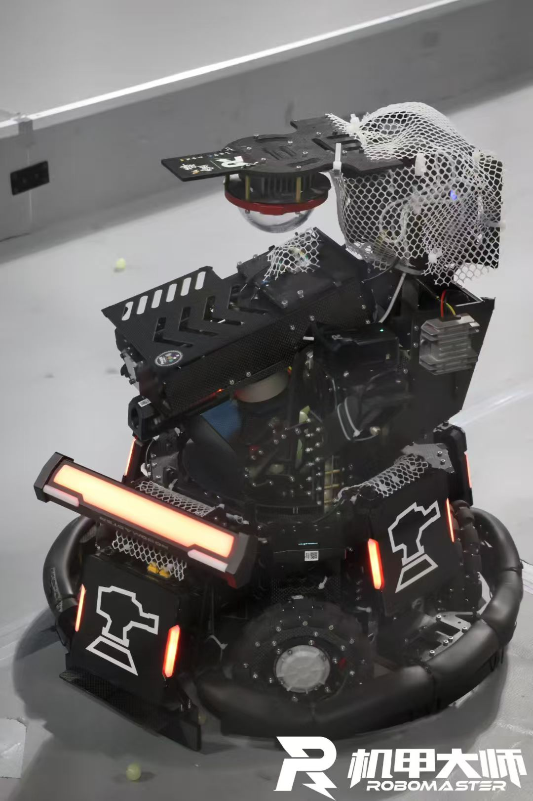
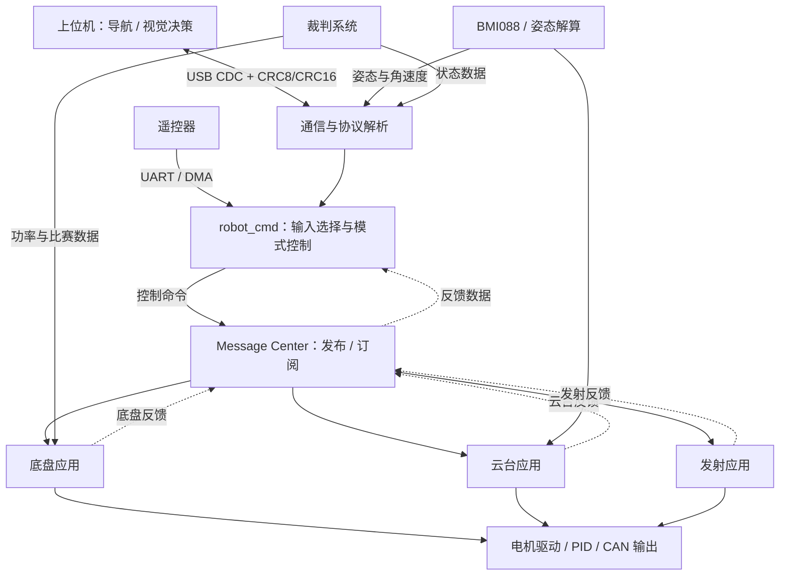

# RM Sentry · 哨兵机器人嵌入式电控系统

[](https://github.com/yz-0609/rm-sentry/actions/workflows/firmware-build.yml)

基于 **STM32F407 + FreeRTOS** 的 RoboMaster 哨兵机器人电控项目，覆盖底盘、云台、发射机构、姿态解算和上下位机通信，完成导航速度、视觉目标与执行机构之间的控制衔接。

**技术栈：** C · STM32F407 · FreeRTOS · CAN · UART/DMA · USB CDC · BMI088 · PID · 底盘运动学

<p align="center">
  
</p>

[核心实现](#核心实现) · [系统架构](#系统架构) · [当前代码状态](#当前代码状态) · [代码导航](#代码导航) · [构建与调试](#构建与调试)

## 项目概览

本项目承担机器人嵌入式电控系统的开发与整车联调：将遥控器和上位机输入转换为底盘速度、云台角度及发射指令，通过电机反馈与 IMU 姿态完成闭环控制，并向上位机回传姿态和机器人状态。

主要工作包括：

- **整车应用开发：** 组织底盘、云台、发射机构的控制逻辑，实现手动移动、小陀螺、视觉控制、比赛和零力模式。
- **RTOS 任务组织：** 按姿态解算、电机控制、整车应用、在线监测和 UI 划分任务，配置优先级与调度周期。
- **模块解耦：** 采用 `application / modules / bsp` 分层结构，通过发布订阅传递控制命令与反馈数据。
- **电机与板间通信：** 封装双路 CAN 电机控制帧、反馈解析和板间数据协议，传递控制模式、速度与相对角度。
- **运动学与闭环控制：** 实现底盘坐标变换与轮组解算，提供舵轮最短转向候选实现，使用 PID 驱动底盘、云台和发射机构。
- **上下位机联调：** 通过 USB CDC 接收导航速度、云台目标角度和发射指令，完成帧封装、解析与 CRC8/CRC16 校验。

> 当前仓库默认运行 **全向轮底盘 + 单板** 配置；**四舵轮底盘 + 双板** 已提供独立候选实现，默认关闭，尚未接入整车任务入口。各实现的状态见[当前代码状态](#当前代码状态)。

## 核心实现

### 1. 底盘运动学与舵轮最短转向

现有底盘应用根据云台与底盘的相对角度，将速度命令转换到底盘坐标系，再完成全向轮解算；支持云台跟随、不跟随和小陀螺运动。

四舵轮候选模块将车体平移与旋转分解为每个轮组的速度。对于轮组位置 `(x_i, y_i)`：

```text
wheel_vx = vx - wz × y_i
wheel_vy = vy + wz × x_i
wheel_speed = hypot(wheel_vx, wheel_vy)
wheel_angle = atan2(wheel_vy, wheel_vx)
```

候选模块采用 `x` 向前、`y` 向右、正 `wz` 俯视顺时针的坐标约定，长度使用 mm、角速度使用 rad/s。

- 将目标角与当前舵角的差归一化；转向超过 90° 时反向驱动，缩短舵向行程。
- 低速和零速时保持上次舵向，避免目标角度随微小速度变化抖动。
- 根据转向误差降低驱动速度，并按统一比例限制四轮 RPM。
- 根据电机速度与舵向反馈估计车体速度，处理轮径、驱动减速比和单位转换。
- 对无效参数、异常命令、通信超时及电机离线执行停机处理。

代码入口：[现有底盘](application/chassis/chassis.c) · [舵轮候选实现](application/chassis/steering.c) · [舵轮配置与接口](application/chassis/steering.h)

### 2. 电机闭环与执行机构控制

电机驱动提供角度、速度、电流三种 PID 环的组合接口，按机构需求选择反馈来源和启用的闭环。

| 机构 | 电机与反馈 | 当前控制配置 |
| --- | --- | --- |
| 现有底盘驱动 | 4 × M3508，编码器速度反馈 | 速度 PID 与驱动功率控制 |
| 舵轮候选驱动 | 4 × M3508，编码器速度反馈 | 速度 PID，参考值使用 RPM |
| 舵轮候选转向 | 4 × GM6020，编码器角度与速度反馈 | 角度 → 速度串级 PID |
| 云台 Yaw | GM6020，BMI088 姿态与角速度反馈 | 角度 → 速度串级 PID |
| 云台 Pitch | GM6020，BMI088 姿态反馈 | 当前启用角度环，保留速度环配置 |
| 摩擦轮与拨弹轮 | 2 × M3508 + 1 × M2006 | 速度 PID，支持摩擦轮开关与连续拨弹 |

云台控制处理多圈 Yaw 目标，并在退出零力或急停后重新对齐目标与反馈。发射机构使用电流阈值触发拨弹反转处理。

代码入口：[DJI 电机驱动](modules/motor/DJImotor/dji_motor.c) · [PID 算法](modules/algorithm/controller.c) · [云台](application/gimbal/gimbal.c) · [发射机构](application/shoot/shoot.c)

### 3. 双 CAN 与上下位机通信

**电机通信：** 两路 CAN 分担执行机构，驱动统一处理反馈解析、电机分组和控制帧发送。舵轮候选配置如下，硬件电机编号均为 `1～4`：

| 总线 | 电机 | 反馈 ID | 分组控制 ID |
| --- | --- | --- | --- |
| CAN1 | 4 × M3508 驱动电机 | `0x201～0x204` | `0x200` |
| CAN2 | 4 × GM6020 舵向电机 | `0x205～0x208` | `0x1FF` |

**板间通信：** `CANComm` 对应用数据进行分包与重组，使用帧头、长度、CRC8 和帧尾校验；复用 `Chassis_Ctrl_Cmd_s` 与 `Chassis_Upload_Data_s` 交换控制模式、速度、相对角度和底盘反馈。底盘侧发送 `0x311`、接收 `0x312`，云台侧收发 ID 对应互换。

**上位机通信：** 默认启用 USB CDC。接收导航速度、云台目标和发射命令，检查实际接收长度、帧头 CRC8 和整包 CRC16，通过校验后才更新视觉控制数据与接收时间。

```text
上位机 → 下位机：导航速度 / 云台目标角度 / 摩擦轮与发射指令
下位机 → 上位机：IMU 姿态与角速度 / 比赛状态 / RFID / 机器人状态
```

当前 USB 发送流程启用上述状态数据；底盘运动数据包和发送接口已保留，尚未在 `UsbSendData()` 中启用。

UART 服务使用 DMA 与空闲接收回调，分别支撑遥控器、裁判系统及可选串口通信。

代码入口：[USB 协议与收发](modules/master_machine/master_process.c) · [数据结构](modules/master_machine/usb_typdef.h) · [CANComm](modules/can_comm/can_comm.c) · [UART/DMA 服务](bsp/usart/bsp_usart.c)

### 4. 模式切换与异常处理

`robot_cmd` 集中处理输入选择、模式转换和执行机构命令，减少模式切换时上周期输出残留对当前控制的影响。

- 视觉命令超过 **120 ms** 未更新时，视觉控制模式进入对应降级处理，平移与自旋命令归零、停止发射。
- 遥控器无效开关组合回退到安全模式；拨轮急停重置各执行机构控制输出。
- 云台恢复控制时重新同步目标，减少角度目标突变。
- `Daemon` 监测模块在线状态；舵轮候选任务进一步检查命令超时、首次有效反馈及全部八个电机在线状态。

代码入口：[命令与模式控制](application/cmd/robot_cmd.c) · [在线监测](modules/daemon/daemon.c)

## 系统架构



图中为单板应用数据流。双板配置通过 `CANComm` 替代底盘与命令模块之间的本地消息通道，上位机承担导航和视觉决策，下位机负责命令执行、电机控制与状态反馈。

### 分层与任务组织

| 层级 | 目录 | 职责 |
| --- | --- | --- |
| 应用层 | `application/` | 整车模式、底盘、云台、发射及参数定义 |
| 模块层 | `modules/` | 电机、IMU、PID、通信协议、消息中心及在线监测 |
| BSP 层 | `bsp/` | CAN、UART、SPI、USB、PWM、DWT 等外设服务 |
| 平台层 | `Src/`、`Inc/`、`Drivers/`、`Middlewares/` | STM32 HAL、FreeRTOS、USB、CMSIS-DSP 与调试组件 |

| FreeRTOS 任务 | 配置的调度间隔 | 优先级 | 工作内容 |
| --- | --- | --- | --- |
| INS | 1 ms | AboveNormal | BMI088 采样、四元数 EKF 姿态解算与 USB 状态发送 |
| Motor | 1 ms | Normal | 电机 PID、驱动功率控制与 CAN 输出 |
| Robot | 5 ms | Normal | 命令更新，依次执行底盘、云台和发射应用 |
| Daemon | 10 ms | Normal | 在线监测与蜂鸣器告警 |
| UI | 1 ms，发送过程包含等待 | Normal | 裁判系统 UI 更新 |

这些间隔来自任务中的 `osDelay()` 配置，实际周期还受任务执行时间与调度影响。底盘、云台和发射应用在同一个 Robot 任务中更新；高频电机控制与姿态解算由独立任务执行。

任务入口：[robot.c](application/robot.c) · [robot_task.h](application/robot_task.h)

## 当前代码状态

| 实现 | 状态 | 配置与入口 |
| --- | --- | --- |
| 全向轮底盘 + 单板 | 当前默认配置 | `ONE_BOARD`，`ChassisInit()` / `ChassisTask()` |
| 双板通信 | 已保留通信实现与条件编译分支 | `CHASSIS_BOARD` / `GIMBAL_BOARD`，`CANComm` |
| 四舵轮底盘 + 双板 | 独立候选实现，默认关闭 | `STEERING_CANDIDATE_ENABLE=0`，`SteeringInit()` / `SteeringTask()` |
| 上位机通信 | 当前默认 USB CDC | `VISION_USE_VCP`；串口分支保留 |

四舵轮候选模块按 **6020 直驱、舵向可连续旋转** 设计，启用时需要标定轮组位置、轮径、驱动减速比、舵向零位、安装方向、PID 与导航角度参考。候选入口必须替代现有底盘入口，不能同时注册两套底盘电机。

当前 `Makefile` 尚未列入 `steering.c`；CMake 重新配置时会收集该文件，但默认关闭时不产生控制代码。双板舵轮的正式接入与实机联调仍需完成。现有功率控制只覆盖四个驱动电机，不代表八电机总功率限制。

仓库保留了通用三环驱动接口和部分历史模块，具体启用的闭环、发送数据和运行模式以当前应用配置为准。

## 代码导航

| 阅读目标 | 入口 |
| --- | --- |
| 整车初始化与应用执行顺序 | [application/robot.c](application/robot.c) |
| RTOS 任务、优先级与周期 | [application/robot_task.h](application/robot_task.h) |
| 板型、机械参数与控制数据定义 | [application/robot_def.h](application/robot_def.h) |
| 遥控器、视觉输入与控制模式 | [application/cmd/robot_cmd.c](application/cmd/robot_cmd.c) |
| 舵轮解算与最短转向 | [application/chassis/steering.c](application/chassis/steering.c) |
| 电机分组、反馈解析与 PID 控制 | [modules/motor/DJImotor/dji_motor.c](modules/motor/DJImotor/dji_motor.c) |
| 驱动功率控制与超级电容接口 | [modules/motor/power_control.c](modules/motor/power_control.c) |
| 上下位机协议与 CRC 校验 | [modules/master_machine/master_process.c](modules/master_machine/master_process.c) |
| BMI088 采样与姿态解算 | [modules/imu/ins_task.c](modules/imu/ins_task.c) |
| 应用间发布订阅 | [modules/message_center/message_center.c](modules/message_center/message_center.c) |

更多说明：[应用层](application/application.md) · [模块层](modules/module.md) · [BSP 层](bsp/bsp.md)

## 构建与调试

目标平台为 **STM32F407IGHx / Cortex-M4F**。默认使用 Arm GNU Toolchain 与 Make，VS Code 任务采用 `mingw32-make`；使用 GNU Make 的环境可将命令替换为 `make`。

```powershell
# 检查工具链
arm-none-eabi-gcc --version
mingw32-make --version

# 编译
mingw32-make -j4
```

输出文件：`build/basic_framework.elf`、`build/basic_framework.hex`、`build/basic_framework.bin`。

[Firmware Build](.github/workflows/firmware-build.yml) 会在推送到 `main` 或提交 Pull Request 时自动编译默认固件，并检查三个输出文件是否生成；也支持在 GitHub Actions 页面手动运行。页面顶部的[状态徽章](https://docs.github.com/en/actions/how-tos/monitor-workflows/add-a-status-badge)跟踪 `main` 分支推送触发的构建结果。

<details>
<summary>展开硬件配置、烧录与调试说明</summary>

编译目标由 [Makefile](Makefile) 定义，外设配置位于 [basic_framework.ioc](basic_framework.ioc)。仓库同时保留 [CMakeLists.txt](CMakeLists.txt) 供 CMake 工作流使用。

| 接口 | 当前配置 | 用途 |
| --- | --- | --- |
| CAN1 / CAN2 | 1 Mbit/s | 电机、可选板间通信与超级电容 |
| USART1 | 921600 bit/s | 可选串口视觉通信，默认使用 USB CDC |
| USART3 | 100000 bit/s、偶校验 | DT7/DR16 遥控器 |
| USART6 | 115200 bit/s | 裁判系统与 UI |
| SPI1 | BMI088 | 加速度与角速度采样 |
| USB FS | Device / CDC | 上下位机双向通信 |

板型、轴距、轮距、轮径和云台零位集中在 [robot_def.h](application/robot_def.h)。`ONE_BOARD`、`CHASSIS_BOARD`、`GIMBAL_BOARD` 只能启用一种。电机总线、ID、方向与 PID 在各应用初始化中配置。

DAP-Link 使用 OpenOCD，J-Link 使用 J-Flash：

```powershell
mingw32-make download_dap
# 或
mingw32-make download_jlink
```

VS Code 的构建与烧录任务位于 [.vscode/tasks.json](.vscode/tasks.json)，调试配置位于 [.vscode/launch.json](.vscode/launch.json)。

首次联调应先完成机械参数与电机方向标定，并在架空底盘、移除弹丸的条件下验证零力模式、急停和视觉离线处理。

</details>

<details>
<summary>展开遥控器模式与恢复操作</summary>

| 左侧开关 | 右侧开关 | 模式 | 行为 |
| --- | --- | --- | --- |
| 下 | 下 | 零力模式 | 底盘、云台进入零力控制，发射机构关闭 |
| 下 | 中 | 摩擦轮模式 | 手动控制底盘与云台，仅启动摩擦轮 |
| 下 | 上 | 遥控发射模式 | 手动控制底盘与云台，摩擦轮和拨弹轮工作 |
| 中 | 下 | 比赛模式 | 上位机控制导航、云台与发射机构 |
| 上 | 下 | 手动移动模式 | 底盘跟随云台，发射机构关闭 |
| 上 | 中 | 小陀螺模式 | 手动移动与底盘定速旋转 |
| 上 | 上 | 视觉云台发射模式 | 底盘零力，视觉控制云台与发射机构 |
| 其他组合 | — | 安全模式 | 回退到安全默认输出 |

拨轮输入超过当前阈值 `300` 时触发急停。释放拨轮并将右侧开关置于“上”后恢复 `ROBOT_READY`，云台重新同步目标与反馈。

</details>

## 致谢

本项目基于湖南大学 RoboMaster 跃鹿战队的 `basic_framework` 持续开发，感谢原框架作者与相关开源贡献者。
