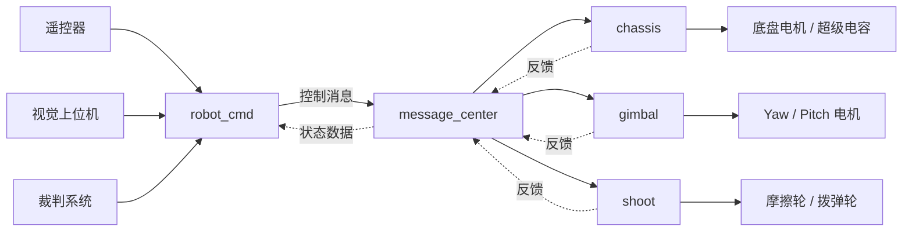

# RM Sentry

> 基于 STM32F407 的 RoboMaster 哨兵机器人嵌入式控制工程

<p align="center">
  
</p>

## 项目概览

RM Sentry 是面向 RoboMaster 哨兵机器人的整车嵌入式控制工程，覆盖底盘、云台、发射机构、遥控器、视觉通信、裁判系统和安全保护等功能。项目使用 STM32 HAL 与 FreeRTOS 组织实时任务，并通过发布-订阅消息中心解耦各个整车应用。

当前代码的默认目标平台和软件环境如下：

| 项目 | 当前配置 |
| --- | --- |
| MCU | STM32F407IGHx / Cortex-M4F |
| 语言标准 | C11 |
| 硬件抽象 | STM32 HAL |
| 实时系统 | FreeRTOS，CMSIS-RTOS v1 接口 |
| 数学与信号处理 | CMSIS-DSP |
| 日志 | SEGGER RTT |
| 默认板型 | `ONE_BOARD`，单板控制整车 |
| 构建工具 | Arm GNU Toolchain + Make，CMake 可选 |

本文档只介绍当前代码中实际启用或已经明确接入的能力。仓库中还保留了一些可复用模块和历史文档，它们不一定参与当前固件运行。

## 主要功能

### 底盘

- 四轮底盘运动解算，支持云台坐标系速度输入。
- 云台跟随、小陀螺和视觉导航速度控制。
- 四个 M3508 底盘电机的速度闭环与功率控制。
- 裁判系统功率数据、超级电容和自定义 UI 接口。

### 云台

- Yaw、Pitch 双 GM6020 电机控制。
- 使用 IMU 姿态和角速度作为闭环反馈。
- 支持手动控制、视觉目标跟踪和连续 Yaw 目标处理。
- 视觉目标丢失后执行哨兵巡查，并在退出零力或急停状态后重新对齐目标。

### 发射机构

- 双 M3508 摩擦轮和 M2006 拨弹电机。
- 支持摩擦轮独立启动、停止拨弹和连续发射。
- 已接入裁判系统枪口热量数据；实际发射限制逻辑应在上场前结合当前代码复核。

### 通信与安全

- DT7/DR16 遥控器、视觉上位机、裁判系统和 USB 虚拟串口。
- 双 CAN 总线、电机在线检测、守护任务和蜂鸣器告警。
- 应用间通过消息中心交换控制指令与反馈数据。
- 视觉命令超过 120 ms 未更新时进入对应的离线处理。
- 支持零力模式、无效开关组合回退到安全模式，以及遥控器拨轮急停。

## 硬件与通信接口

以下映射来自当前 CubeMX 配置和应用初始化代码：

| 接口 | 参数 | 当前用途 |
| --- | --- | --- |
| USART1 | 921600 bit/s | 视觉上位机通信 |
| USART3 | 100000 bit/s、偶校验 | DT7/DR16 遥控器 DBUS |
| USART6 | 异步串口 | RoboMaster 裁判系统与自定义 UI |
| CAN1 | 1 Mbit/s | 底盘电机及部分发射电机 |
| CAN2 | 1 Mbit/s | 云台、拨弹、部分发射电机和超级电容 |
| SPI1 | 主机模式 | BMI088 IMU |
| USB FS | Device / CDC | 视觉数据虚拟串口通道 |

当前执行机构配置：

| 机构 | 电机 |
| --- | --- |
| 底盘 | 4 × DJI M3508 |
| 云台 | 2 × DJI GM6020 |
| 摩擦轮 | 2 × DJI M3508 |
| 拨弹轮 | 1 × DJI M2006 |

CAN 总线、电机 ID、旋转方向和 PID 参数以各应用初始化代码为准：

- [底盘配置](application/chassis/chassis.c)
- [云台配置](application/gimbal/gimbal.c)
- [发射配置](application/shoot/shoot.c)

板型、机械尺寸、云台零位和发射机构参数集中在 [application/robot_def.h](application/robot_def.h)。修改其中的板型宏后必须重新编译，并确保 `ONE_BOARD`、`CHASSIS_BOARD`、`GIMBAL_BOARD` 中只启用一种配置。

## 软件架构

项目按职责分为三层：

- `bsp`：封装 CAN、USART、SPI、I²C、GPIO、PWM、USB、DWT 和日志等板级外设。
- `modules`：提供电机、IMU、遥控器、视觉协议、裁判系统、消息中心、守护模块和控制算法。
- `application`：组织 `robot_cmd`、`chassis`、`gimbal`、`shoot` 等整车应用。



### FreeRTOS 任务

| 任务 | 典型周期 | 主要职责 |
| --- | ---: | --- |
| INS | 1 ms | BMI088 采样与姿态解算、视觉数据发送 |
| Motor | 1 ms | 电机控制与 CAN 输出 |
| Robot | 5 ms | 命令解析、底盘、云台和发射应用更新 |
| Daemon | 10 ms | 模块在线监测与蜂鸣器告警 |
| UI | 1 ms 调度 | 裁判系统 UI 数据发送 |

`RobotInit()` 是整车功能的统一初始化入口，`RobotTask()` 负责周期执行各应用逻辑。

## 目录导航

```text
.
├─ application/        # 整车应用、控制模式和机器人参数
├─ bsp/                # 板级外设抽象
├─ modules/            # 电机、传感器、通信、算法和消息中心
├─ Src/                # STM32CubeMX 生成与用户源文件
├─ Inc/                # STM32CubeMX 生成与用户头文件
├─ Drivers/            # STM32 HAL 与 CMSIS
├─ Middlewares/        # FreeRTOS、USB、CMSIS-DSP、SEGGER RTT
├─ .vscode/            # 构建、烧录和调试任务
├─ .Doc/               # 架构、开发环境和调试资料
├─ basic_framework.ioc # STM32CubeMX 工程
├─ Makefile            # 默认构建与烧录入口
└─ CMakeLists.txt      # 可选 CMake 构建配置
```

建议从上到下阅读：

1. [机器人参数定义](application/robot_def.h)
2. [命令与模式控制](application/cmd/robot_cmd.c)
3. [整车应用说明](application/application.md)
4. [模块层说明](modules/module.md)
5. [BSP 层说明](bsp/bsp.md)

`.Doc` 和部分模块文档继承自项目早期使用的通用框架，可能包含未启用模块或旧工作流。当前固件行为始终以源码、`Makefile` 和 `basic_framework.ioc` 为准。

## 快速开始

### 1. 准备开发环境

必须安装并加入 `PATH`：

- Arm GNU Toolchain，提供 `arm-none-eabi-gcc`、`objcopy` 和 `size`。
- MSYS2/MinGW Make，Windows 下默认命令为 `mingw32-make`。

烧录和调试还需要：

- DAP-Link：OpenOCD。
- J-Link：J-Flash/J-Link 工具；VS Code 调试配置也支持 OpenOCD 或 J-Link GDB Server。

可以先检查工具是否可用：

```powershell
arm-none-eabi-gcc --version
mingw32-make --version
```

### 2. 检查机器人配置

编译和上电前至少确认：

1. `application/robot_def.h` 中的板型宏与实际主控布局一致。
2. 轴距、轮距、轮径、云台零位和发射机构参数已经标定。
3. 各应用中的 CAN 总线、电机 ID、方向和 PID 与实机一致。
4. USART1、USART3、USART6 的外部设备连接正确。
5. 急停、零力模式和视觉离线处理能够可靠触发。

### 3. 编译

```powershell
mingw32-make -j24
```

如果并行输出影响排查错误，可改用：

```powershell
mingw32-make
```

默认生成：

```text
build/basic_framework.elf
build/basic_framework.hex
build/basic_framework.bin
```

VS Code 中也可以运行默认的 `build task`。仓库保留了 `CMakeLists.txt` 供需要 CMake/Ninja 工作流的开发者使用，但当前默认工作流仍以 `Makefile` 为准。

### 4. 烧录

DAP-Link：

```powershell
mingw32-make download_dap
```

J-Link：

```powershell
mingw32-make download_jlink
```

对应命令也已经配置在 [.vscode/tasks.json](.vscode/tasks.json) 中。调试配置位于 [.vscode/launch.json](.vscode/launch.json)。

## 遥控器模式

当前模式由遥控器左右三段开关共同决定：

| 左侧开关 | 右侧开关 | 模式 | 主要行为 |
| --- | --- | --- | --- |
| 下 | 下 | 零力模式 | 底盘、云台和发射机构进入安全输出 |
| 下 | 中 | 摩擦轮模式 | 手动控制底盘/云台，仅启动摩擦轮 |
| 下 | 上 | 遥控发射模式 | 手动控制底盘/云台，摩擦轮与拨弹轮工作 |
| 中 | 下 | 比赛模式 | 视觉控制导航、云台和发射机构 |
| 上 | 下 | 手动移动模式 | 底盘跟随云台，发射机构关闭 |
| 上 | 中 | 小陀螺模式 | 手动移动，底盘定速旋转 |
| 上 | 上 | 视觉云台发射模式 | 底盘保持零力，视觉控制云台和发射机构 |
| 其他组合 | — | 安全模式 | 回退到安全输出 |

比赛模式和视觉云台发射模式会检测视觉命令是否在线。视觉数据超时后的具体降级策略由 [application/cmd/robot_cmd.c](application/cmd/robot_cmd.c) 中的离线处理逻辑决定，修改通信协议或超时时间时应同步检查该逻辑。

### 急停与恢复

- 遥控器左上侧拨轮向下超过当前阈值（代码中为 `300`）后触发急停。
- 急停会将底盘、云台和发射机构恢复为安全默认输出。
- 释放拨轮并将右侧三段开关置于“上”后，系统恢复到 `ROBOT_READY`。
- 恢复工作时云台会先将目标同步到最新反馈，避免角度目标突变。

## 安全说明

> 本工程能够直接驱动大功率电机和发射机构。任何配置错误都可能导致机器人突然运动、机械损坏或人员受伤。

首次调试或修改关键参数后：

1. 架空底盘，移除弹丸，并确保机器人周围没有人员和障碍物。
2. 从零力模式上电，逐个确认 CAN 总线、电机 ID 和旋转方向。
3. 分别验证底盘、Yaw、Pitch、摩擦轮和拨弹轮，不要直接进入比赛模式。
4. 确认云台机械限位、零位、PID 和反馈方向正确。
5. 实测遥控器急停和视觉离线保护后，再进行整车联调。

## 致谢

本项目在 `basic_framework` 的基础上持续开发，感谢湖南大学 RoboMaster 跃鹿战队原作者以及所有相关开源贡献者。
